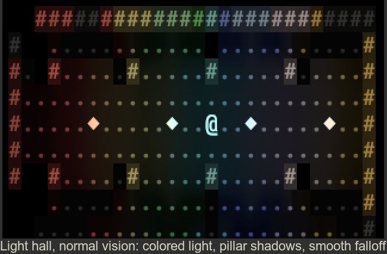

# Warlock

**Play in your browser: https://jannef.github.io/warlock/** (updated with each release; needs a WebGPU browser and a keyboard)

**Read the wiki: https://jannef.github.io/warlock/wiki/** (what is in the game and how it works; its source is in [`wiki/`](wiki/))

A turn-based ASCII roguelike in the spirit of ADOM, drawn entirely in glyphs and rendered on the
GPU: colored light with real shadows, vision that depends on your eyes, gently animated terrain,
and glyph-based effects — while every character stays crisp and readable.



You play the Ascmearc, the first campaign: you come through the pass of Beorggeat into the ash
march, where no road leads home. Its overworld has day and night, moons, and weather, and its
wilds are generated as you walk them; its towns and villages have shops, people to talk to, and
quests; its dungeons, hand-made and generated, go deep. Creatures hunt you, fight, shoot, and die,
death is permanent, and you grow by experience levels, talents, and skills that improve with use.
The wiki's [What's in the
game](https://jannef.github.io/warlock/wiki/features.html) walks through every feature, with
screenshots; its [Controls](https://jannef.github.io/warlock/wiki/controls.html) page lists the
keys (in the game, `?` shows your own bindings).

## Play

Download a build for Windows, macOS, or Linux from the
[releases](https://github.com/jannef/warlock/releases), play in the browser at the link above, or
run from source with a recent Rust toolchain (the exact version is pinned in
`rust-toolchain.toml`):

```sh
cargo run --release -p warlock
```

### Install a specific version from source

To play a locked release from source, install it with `cargo install` (a tag picks the version):

```sh
cargo install --git https://github.com/jannef/warlock --tag v0.17.0 --locked --no-default-features warlock
```

- `--locked` uses the release's `Cargo.lock`. `--no-default-features` leaves out the test world,
  as the release builds do. Add `warlock-cli` after `warlock` for the headless tool too.
- It needs a Rust toolchain of at least 1.99 (`rust-version`); outside the repository,
  `rust-toolchain.toml` does not apply.
- The result is a bare binary in `~/.cargo/bin`, not a macOS `.app`; a local build has no
  quarantine flag, so Gatekeeper does not block it.
- It shares settings and saves with the downloaded game, which use the same data folder. Saves are
  shared between builds of the same major.minor version, and an older tag cannot load newer saves;
  `--portable DIR` keeps an old version's saves and settings apart.
- `cargo install warlock` from crates.io is not offered: the crates are not published.

## Develop

- What we are building: [`specification.md`](specification.md) (the index; the sections are in
  [`spec/`](spec/))
- How to build, test, verify, and contribute: [`CLAUDE.md`](CLAUDE.md); notes per subsystem in
  [`docs/dev/`](docs/dev/), the merging playbook in [`docs/dev/merging.md`](docs/dev/merging.md), the command-line reference
  (flags, dump layers, action text) in [`docs/dev/cli.md`](docs/dev/cli.md)

```sh
cargo test --workspace                                   # tests
cargo run -p warlock -- --scale 1 --capture shot.png     # render offscreen, save a screenshot
cargo run -p warlock -- --scenario depths --character dwarf,female,warrior   # start as a dwarf
cargo run -p warlock-cli -- dump --scenario showcase --actions "move:N move:N" --layers view
```

The simulation lives in `warlock-core` (plain Rust, deterministic, no engine); the game is a
[Bevy](https://bevy.org) 0.20 app on top of it. Feature work changes the wiki, the spec, and the
developer notes, not this file.

## License

Copyright © 2026 Janne Lê Forsell.

Warlock is free software: you can redistribute it and/or modify it under the terms of the
[GNU General Public License, version 3](LICENSE), as published by the Free Software Foundation.
It is distributed in the hope that it will be useful, but WITHOUT ANY WARRANTY; without even the
implied warranty of MERCHANTABILITY or FITNESS FOR A PARTICULAR PURPOSE. See the license for
details.

## Credits

Font: [JuliaMono](https://github.com/cormullion/juliamono) by cormullion, SIL Open Font License 1.1
(`assets/fonts/JuliaMono-OFL.txt`).

Dependencies: Warlock is built on Bevy, wgpu, and several hundred other open-source Rust crates.
Their copyright notices and license texts are in
[`THIRD_PARTY_LICENSES.html`](THIRD_PARTY_LICENSES.html) (generated with `cargo xtask licenses`),
which also ships in every release archive and the web build.
