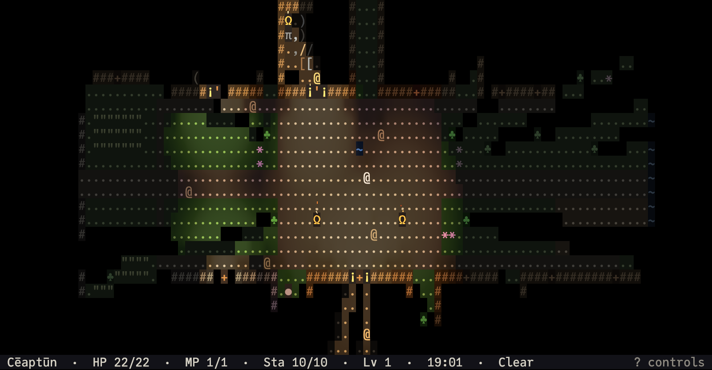
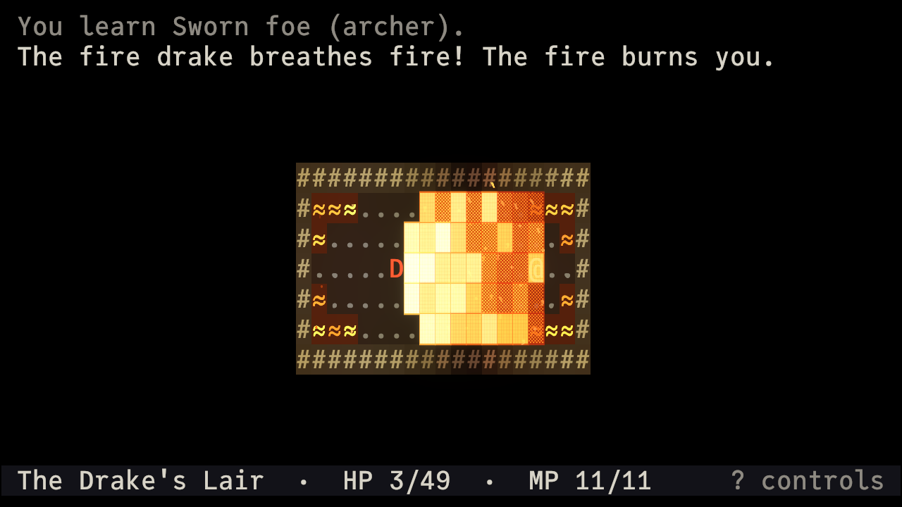
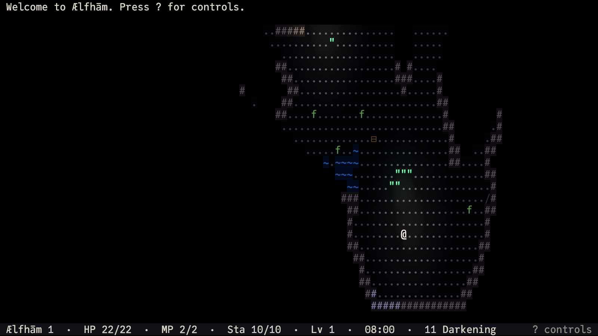
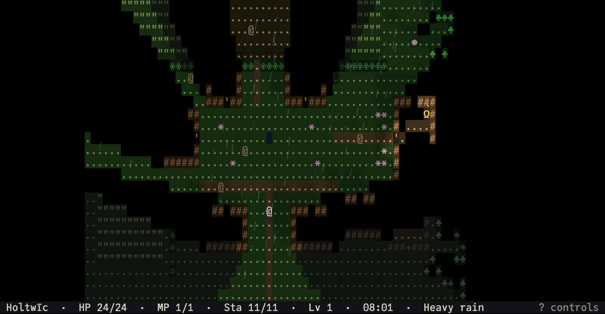
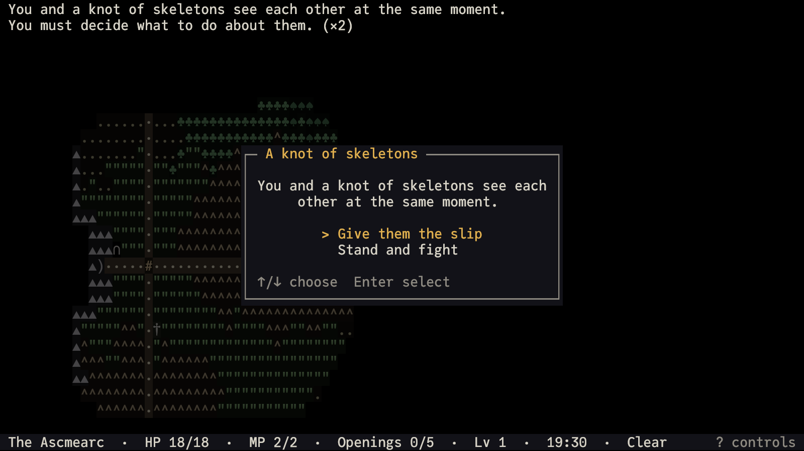
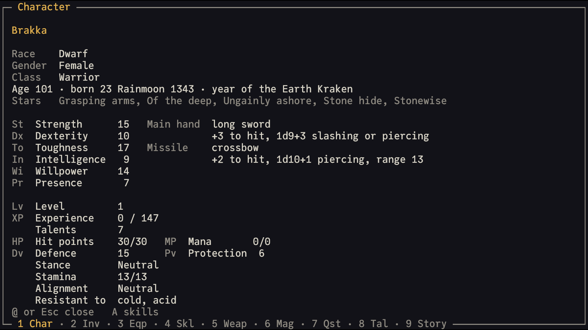

# Warlock

**A turn-based fantasy roguelike drawn entirely in glyphs, with real light and shadow.**

**[Play in your browser](https://jannef.github.io/warlock/)** ·
**[Download](https://github.com/jannef/warlock/releases/latest)** ·
**[Read the wiki](https://jannef.github.io/warlock/wiki/)**



Warlock is a classic roguelike in the spirit of ADOM: every turn is yours to think about, the
world is full of things to find, and death is permanent. It looks like an old terminal game, but
the GPU gives every glyph colored light, soft shadows, and a gentle touch of animation, so a
torchlit square at dusk or a dragon's breath in a lava hall looks the part, and every character
stays crisp and readable.

## The game

You come over the mountains into **the Ascmearc**, the ash march, through a pass that snows shut
behind you. There is no way home. Ahead lie a market town, a village at the end of the north road,
cold barrows, a drowned minster, a hidden fey hall, and a fire mountain that smokes over it all.

- **A living world.** The overworld has day and night, waxing and waning moons, weather, and
  seasons. Its wilds are made as you walk them, and parties of creatures roam the roads.
- **Deep dungeons.** Hand-made levels and levels made anew for every run, with vaults, traps,
  locked doors, secret doors, chests, special rooms, and bosses who guard the way down.
- **Your character.** Thirteen races, each with its own eyes, and fifteen classes, from
  berserker and wizard to witch, thief, and craftsperson. Your birth sign, your background
  story, and the talents you pick make every character different. They are not balanced, on
  purpose.
- **Grow by doing.** Experience levels, skills and weapon skills that improve with use,
  fighting styles, spells to learn and deepen, and prestige classes later on.
- **Things to make.** Forge swords at an anvil, brew potions, cut and set gems, fletch arrows,
  and enchant your gear with magic crystals.
- **People to meet.** Towns with shops, inns, a temple, and a guild; folk to talk to, quests to
  take, and companions and familiars to keep at your side.
- **Light, sight, and sound.** What you see depends on your eyes and the light around you.
  Footsteps and fights carry around corners, and creatures hear you too.
- **One life.** The game saves as you play, and when you die, your save is gone.

## Screenshots

| | |
|---|---|
|  |  |
| The fire drake breathes. | Ælfhām, the hidden fey hall. |
|  |  |
| Heavy rain over Holtwīc. | Night on the road: fight, or give them the slip? |



*The character sheet: one of nine pages about your character.*

The wiki's [What's in the game](https://jannef.github.io/warlock/wiki/features.html) has more
screenshots and a tour of every feature.

## How to play

- **In your browser:** [jannef.github.io/warlock](https://jannef.github.io/warlock/), always the
  latest release. It needs a browser with WebGPU (a recent Chrome or Edge, for example) and a
  keyboard.
- **On your computer:** download the
  [latest release](https://github.com/jannef/warlock/releases/latest) for Windows, macOS (Apple
  silicon), or Linux, unpack it, and run it.
- **New to the game?** Start with [Your first run](https://jannef.github.io/warlock/wiki/first-run.html).
  The [Controls](https://jannef.github.io/warlock/wiki/controls.html) page lists the keys, and in
  the game `?` shows them as you have bound them. Every key can be rebound.
- **Everything else** is in the [wiki](https://jannef.github.io/warlock/wiki/): races, classes,
  creatures, spells, crafting, and every number the game keeps to itself.

## For developers

Warlock is written in Rust. The simulation lives in `warlock-core` (plain Rust, deterministic, no
engine); the game is a [Bevy](https://bevy.org) 0.20 app on top of it.

- What we are building: [`specification.md`](specification.md) (the index; the sections are in
  [`spec/`](spec/))
- How to build, test, verify, and contribute: [`CLAUDE.md`](CLAUDE.md); notes per subsystem in
  [`docs/dev/`](docs/dev/), the merging playbook in [`docs/dev/merging.md`](docs/dev/merging.md),
  the command-line reference (flags, dump layers, action text) in
  [`docs/dev/cli.md`](docs/dev/cli.md)
- The wiki's source is in [`wiki/`](wiki/).

Run from source with a recent Rust toolchain (the exact version is pinned in
`rust-toolchain.toml`):

```sh
cargo run --release -p warlock                           # play
cargo test --workspace                                   # tests
cargo run -p warlock -- --scale 1 --capture shot.png     # render offscreen, save a screenshot
cargo run -p warlock -- --scenario depths --character dwarf,female,warrior   # start as a dwarf
cargo run -p warlock-cli -- dump --scenario showcase --actions "move:N move:N" --layers view
```

Feature work changes the wiki, the spec, and the developer notes, not this file.

### Install a specific version from source

To play a locked release from source, install it with `cargo install` (a tag picks the version):

```sh
cargo install --git https://github.com/jannef/warlock --tag v0.17.0 --locked --no-default-features warlock
```

- `--locked` uses the release's `Cargo.lock`. `--no-default-features` leaves out the test world,
  as the release builds do. Add `warlock-cli` after `warlock` for the headless tool too.
- It needs a Rust toolchain of at least 1.99 (`rust-version`); outside the repository,
  `rust-toolchain.toml` does not apply.
- The result is a bare binary in `~/.cargo/bin`, not a macOS `.app`; a local build has no
  quarantine flag, so Gatekeeper does not block it.
- It shares settings and saves with the downloaded game, which use the same data folder. Saves are
  shared between builds of the same major.minor version, and an older tag cannot load newer saves;
  `--portable DIR` keeps an old version's saves and settings apart.
- `cargo install warlock` from crates.io is not offered: the crates are not published.

## License

Copyright © 2026 Janne Lê Forsell.

Warlock is free software: you can redistribute it and/or modify it under the terms of the
[GNU General Public License, version 3](LICENSE), as published by the Free Software Foundation.
It is distributed in the hope that it will be useful, but WITHOUT ANY WARRANTY; without even the
implied warranty of MERCHANTABILITY or FITNESS FOR A PARTICULAR PURPOSE. See the license for
details.

## Credits

Font: [JuliaMono](https://github.com/cormullion/juliamono) by cormullion, SIL Open Font License 1.1
(`assets/fonts/JuliaMono-OFL.txt`).

Dependencies: Warlock is built on Bevy, wgpu, and several hundred other open-source Rust crates.
Their copyright notices and license texts are in
[`THIRD_PARTY_LICENSES.html`](THIRD_PARTY_LICENSES.html) (generated with `cargo xtask licenses`),
which also ships in every release archive and the web build.
