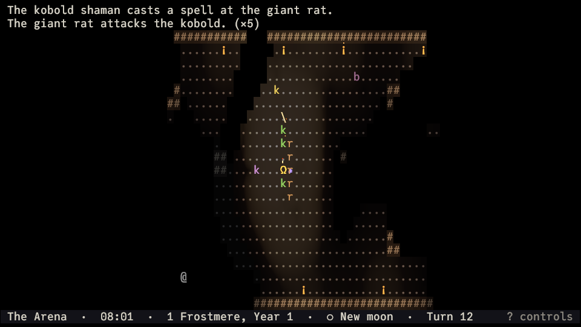
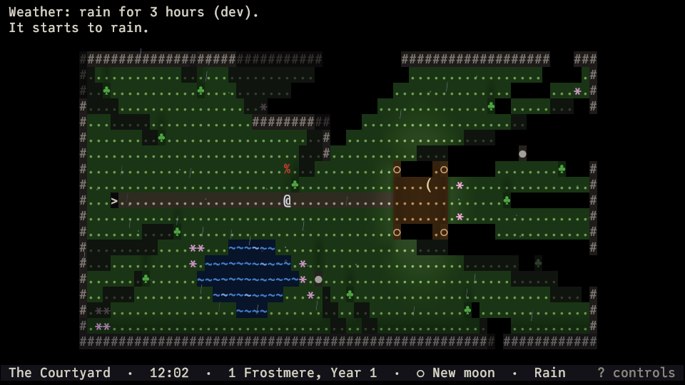

# Warlock

**Play in your browser: https://jannef.github.io/warlock/** (updated with each release; needs a WebGPU browser and a keyboard)

**Read the wiki: https://jannef.github.io/warlock/wiki/** (how time, light, sight, and the overworld work; its source is in [`wiki/`](wiki/))

A turn-based ASCII roguelike in the spirit of ADOM, drawn entirely in glyphs and rendered on the
GPU: colored light with real shadows, vision that depends on your eyes, gently animated terrain,
and glyph-based effects — while every character stays crisp and readable.


This is the engine and framework phase: creatures hunt, shoot, and cast at you, but attacks are only
announced (nothing takes damage yet), and there is no character progression. You walk a hand-made
**showcase world** where each room demonstrates one capability, an arena where kobolds and giant
rats fight, an ADOM-like **overworld** with day and night and weather, outdoor areas generated
from it, a vast lit cavern, and procedurally generated dungeon levels.

## What's in it

- **Light and vision** — every cell carries RGB + UV light from torches, lamps, crystals, braziers,
  and your lantern, with shadows from walls and pillars, soft shadows from creatures, and a weak
  bounce of light off nearby surfaces. Firelight drifts gently in hue and strength; magical light
  holds steady. What you see depends on your eyes: normal
  vision needs light, low-light eyes see by faint fungus glow, darkvision sees in the dark in
  fading monochrome, and UV sight reveals runes no one else can see.

  

- **Creatures** — every creature acts at its own pace (some twice for each of your turns, some
  less; the game never tells you) and belongs to a faction that is hostile or neutral to you and to
  the others. Hostile creatures see by the same rules of light and eyes as you do, then approach
  and attack, keep their distance and shoot, or cast from afar, entirely deterministically; when
  they lose you, they search where they last saw you, follow noises, and return to their rounds.

  

- **Hearing** — footsteps, doors, and fights make noise that travels around corners, is muffled by
  closed doors, and is louder in water and rubble than on grass. You hear what you cannot see as
  faint marks on the map and short messages ("You hear footsteps to the north-east."), without
  learning who made them; creatures hear you too and come to look.
- **Perception and memory** — symmetric line of sight; explored terrain and the objects seen on
  it stay as dim memory, never showing creatures or current light.
- **Objects** — weapons, armor, tools, potions, scrolls, food, gems, coins, rings, and amulets,
  each with its own glyph, color, material, and weight, lie in piles to pick up and drop; an
  ADOM-style inventory lettered a–z shows what you carry and what it weighs, and an ADOM-style
  equipment screen puts it on: helm, amulet, armor, cloak, weapons and shield (or a two-handed
  staff), gloves, rings, boots, a bow and arrows. Creatures wield and wear what they carry, and
  you see it. Equipment takes time to put on but changes no rule yet (combat is next).
- **Stats** — Strength, Dexterity, Toughness, Intelligence, Willpower, and Presence, inspired by
  D&D, for you and every creature; a character screen shows your own. They do not change the
  rules yet.
- **Character creation** — ADOM-style, at the start of every run: seven races (elf, half-elf,
  human, dwarf, halfling, gnome, half-orc), each with its own eyes, three genders, and fifteen
  classes from barbarian and wizard to merchant and commoner shape your starting stats, with
  dice rolled in the background (a warrior's Strength is 1d3+1). Your age and birthday are
  random, and the year you were born gives you a horoscope sign: one of twelve mythological
  animals and five elements, sixty signs in a great cycle (the Fire Manticore, the Water
  Basilisk). Not balanced, on purpose: some characters are a challenge.
- **Living glyphs and effects** — still ponds that glint in the torchlight, streams and a river
  that visibly flow and foam against rocks, a pulsing altar, flickering torches, sparks and
  embers, a soft glow, heat haze over braziers, short fades. All of it is tunable per effect, and
  a reduced-effects preset turns it off.

  

- **Sunlight** — a game clock moves the sun across the sky of outdoor levels: warm and low at dawn
  and dusk, white at noon, with a dim blue sky light in the shade and shadows from trees, walls,
  and stones that turn and stretch with it.

  

- **Moonlight** — by night a faint, slightly purple moon lights the land, waxing and waning with
  the 30-day month and rising about 50 minutes later each day: under a full moon you dimly make out
  open ground (not what lies in its shadows), low-light eyes see by a half moon, and a new moon
  leaves you to your lantern. Moons cast shadows like the sun, widen your sight on the overworld,
  and are data: add more, bigger or faster ones. The status bar shows the date and the phase.

  

- **Weather** — clear skies, overcast, rain, and heavy rain come and go with the season (Rainmoon is
  wet, Highsun dry). Clouds dim the sun and the moon and flatten shadows, for you and every
  creature alike; rain shortens your sight on the overworld, falls as faint drops, and rings the
  ponds. The status bar shows the weather when you are outside.

  

- **Overworld and time** — a 12-month, 30-day calendar and a clock that every action advances.
  "The Wildlands" overworld takes real travel time per step (a road is quick, a swamp slow,
  mountains impassable); how far you see follows the daylight and the moon. Its locations lead to the hub, the
  cavern, and the dungeon, and any other cell opens a generated outdoor area — meadows, forests,
  hills, swamps, riverbanks — that you leave by walking off its edge.

  

  

- **Levels** — the hub, a sunlit courtyard, the arena, a 420×300 cavern, and "The Depths": rooms-and-corridors
  and cave levels generated from the run seed (numbers or words), with hand-made vaults stamped in.

  

- **Saves** — one save per run, written when you quit and autosaved as you play (in the browser
  too).
- **Settings** — font size, color palettes (including high contrast and a colorblind-friendly
  variant), per-effect switches, and fully rebindable keys.
- **Everywhere** — Windows, macOS, Linux, and the browser (WebGPU).

## Play

Download a build from the [releases](https://github.com/jannef/warlock/releases), or run from
source with a recent Rust toolchain (the exact version is pinned in `rust-toolchain.toml`):

```sh
cargo run --release -p warlock
```

| Key | Action |
|---|---|
| `h j k l y u b n`, numpad, arrows | Move (8 directions; arrows move orthogonally); moving into a hostile creature attacks it |
| `.` or numpad 5 | Wait a turn |
| `o` / `c` + direction | Open / close a door (walking into a closed door opens it) |
| `>` / `<` | Go down / up stairs |
| `L` | Light or douse your lantern |
| `,` or `g` | Pick up what lies here (choose by letter where several things lie) |
| `d` | Drop something |
| `i` | Inventory: what you carry, by letter, and what it all weighs |
| `e` | Equipment: wear and wield things, slot by slot (head, body, hands, rings, missiles, …), as in ADOM |
| `@` | Character: your race, gender, class, age, birth sign, stats, and weight |
| `R` | Rest an hour, until dawn, or until nightfall (stops when something comes into view) |
| `x` | Look around: move a cursor to read what is there (takes no time) |
| `?` | Show all controls |
| `Esc` | Pause menu: settings, controls, save and quit |
| `Q` | Save and quit |

Symbol keys follow your keyboard layout, so `<`, `>` and `?` work on non-US keyboards. Every key
can be rebound in the Controls screen. The [wiki](https://jannef.github.io/warlock/wiki/) explains the rules.

## Develop

- What we are building: [`specification.md`](specification.md)
- How to build, test, verify, and contribute: [`CLAUDE.md`](CLAUDE.md)

```sh
cargo test --workspace                                   # tests
cargo run -p warlock -- --scale 1 --capture shot.png     # render offscreen, save a screenshot
cargo run -p warlock -- --scenario depths --character dwarf,female,warrior   # start as a dwarf
cargo run -p warlock-cli -- dump --scenario showcase --actions "move:N move:N" --layers view
```

The simulation lives in `warlock-core` (plain Rust, deterministic, no engine); the game is a
[Bevy](https://bevy.org) 0.20 app on top of it.

## License

Copyright © 2026 Janne Lê Forsell.

Warlock is free software: you can redistribute it and/or modify it under the terms of the
[GNU General Public License, version 3](LICENSE), as published by the Free Software Foundation.
It is distributed in the hope that it will be useful, but WITHOUT ANY WARRANTY; without even the
implied warranty of MERCHANTABILITY or FITNESS FOR A PARTICULAR PURPOSE. See the license for
details.

## Credits

Font: [JuliaMono](https://github.com/cormullion/juliamono) by cormullion, SIL Open Font License 1.1
(`assets/fonts/JuliaMono-OFL.txt`).

Dependencies: Warlock is built on Bevy, wgpu, and several hundred other open-source Rust crates.
Their copyright notices and license texts are in
[`THIRD_PARTY_LICENSES.html`](THIRD_PARTY_LICENSES.html) (generated with `cargo xtask licenses`),
which also ships in every release archive and the web build.
