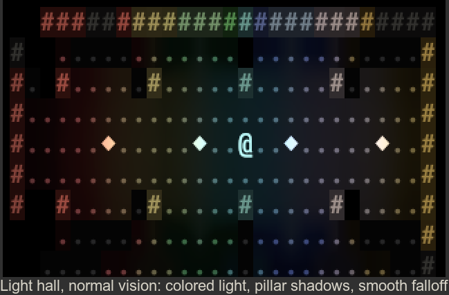
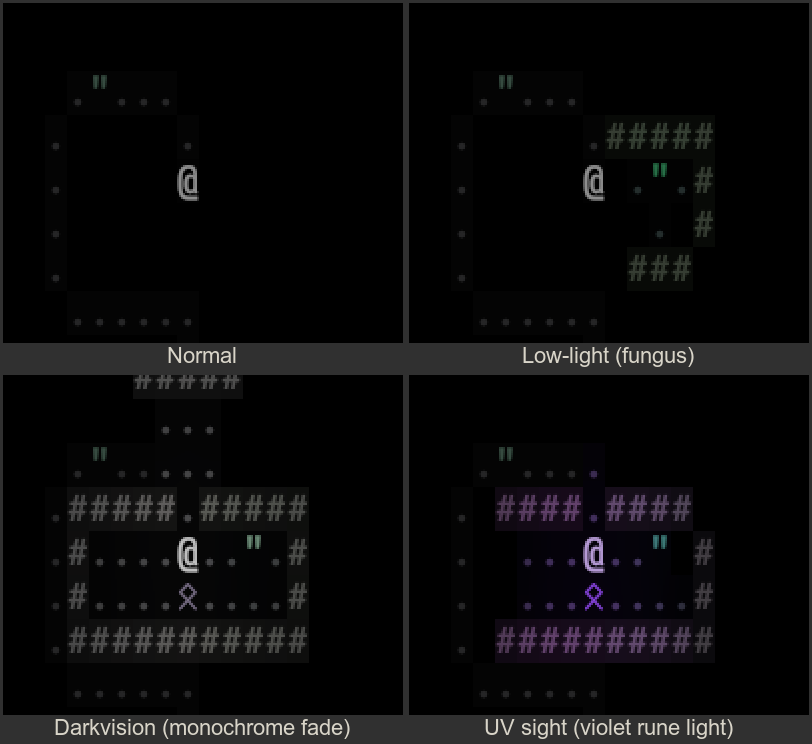
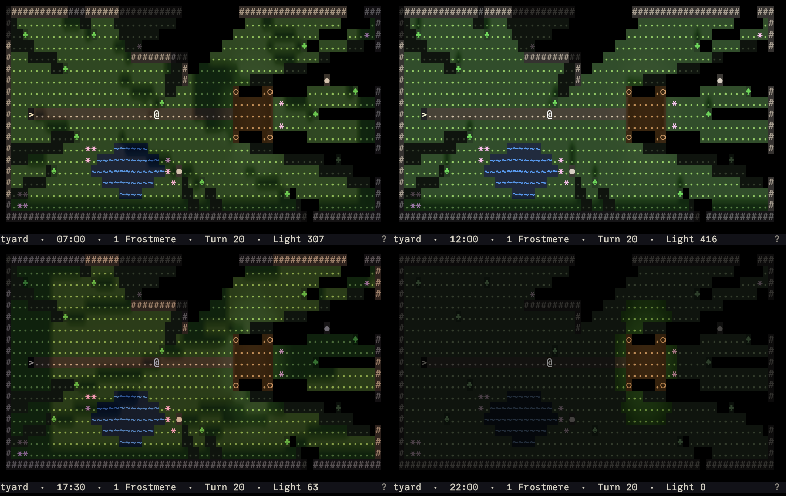
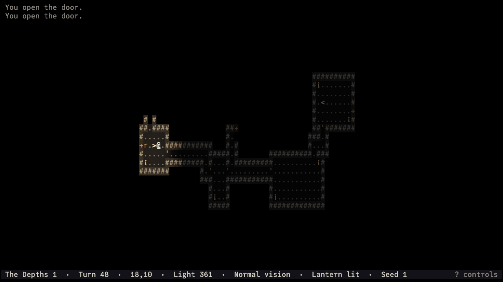

# Warlock

A turn-based ASCII roguelike in the spirit of ADOM, drawn entirely in glyphs and rendered on the
GPU: colored light with real shadows, vision that depends on your eyes, gently animated terrain,
and glyph-based effects — while every character stays crisp and readable.



This is the engine and framework phase: there is no combat or character progression yet. You walk
a hand-made **showcase world** where each room demonstrates one capability, a vast lit cavern, and
procedurally generated dungeon levels below it.

## What's in it

- **Light and vision** — every cell carries RGB + UV light from torches, lamps, crystals, braziers,
  and your lantern, with shadows from walls and pillars. What you see depends on your eyes: normal
  vision needs light, low-light eyes see by faint fungus glow, darkvision sees in the dark in
  fading monochrome, and UV sight reveals runes no one else can see.

  

- **Perception and memory** — symmetric line of sight; explored terrain stays as dim memory, never
  showing creatures or current light.
- **Living glyphs and effects** — still ponds that glint in the torchlight, streams and a river
  that visibly flow and foam against rocks, a pulsing altar, flickering torches, sparks and
  embers, a soft glow, heat haze over braziers, short fades. All of it is tunable per effect, and
  a reduced-effects preset turns it off.

  

- **Sunlight** — a game clock moves the sun across the sky of outdoor levels: warm and low at dawn
  and dusk, white at noon, with a dim blue sky light in the shade and shadows from trees, walls,
  and stones that turn and stretch with it. Night is dark; bring a lantern.

  

- **Levels** — the hub, a sunlit courtyard, a 420×300 cavern, and "The Depths": rooms-and-corridors
  and cave levels generated from the run seed (numbers or words), with hand-made vaults stamped in.

  

- **Saves** — one save per run, written when you quit and autosaved as you play.
- **Settings** — font size, color palettes (including high contrast and a colorblind-friendly
  variant), per-effect switches, and fully rebindable keys.
- **Everywhere** — Windows, macOS, Linux, and the browser (WebGPU).

## Play

Download a build from the [releases](https://github.com/jannef/warlock/releases), or run from
source with a recent Rust toolchain (the exact version is pinned in `rust-toolchain.toml`):

```sh
cargo run --release -p warlock
```

| Key | Action |
|---|---|
| `h j k l y u b n`, numpad, arrows | Move (8 directions; arrows move orthogonally) |
| `.` or numpad 5 | Wait a turn |
| `o` / `c` + direction | Open / close a door (walking into a closed door opens it) |
| `>` / `<` | Go down / up stairs |
| `L` | Light or douse your lantern |
| `R` | Rest an hour, until dawn, or until nightfall (stops when something comes into view) |
| `x` | Look around: move a cursor to read what is there (takes no time) |
| `?` | Show all controls |
| `Esc` | Pause menu: settings, controls, save and quit |
| `Q` | Save and quit |

Symbol keys follow your keyboard layout, so `<`, `>` and `?` work on non-US keyboards. Every key
can be rebound in Settings.

## Develop

- What we are building: [`specification.md`](specification.md)
- How to build, test, verify, and contribute: [`CLAUDE.md`](CLAUDE.md)

```sh
cargo test --workspace                                   # tests
cargo run -p warlock -- --scale 1 --capture shot.png     # render offscreen, save a screenshot
cargo run -p warlock-cli -- dump --scenario showcase --actions "move:N move:N" --layers view
```

The simulation lives in `warlock-core` (plain Rust, deterministic, no engine); the game is a
[Bevy](https://bevy.org) 0.20 app on top of it.

## Credits

Font: [JuliaMono](https://github.com/cormullion/juliamono) by cormullion, SIL Open Font License 1.1
(`assets/fonts/JuliaMono-OFL.txt`).
