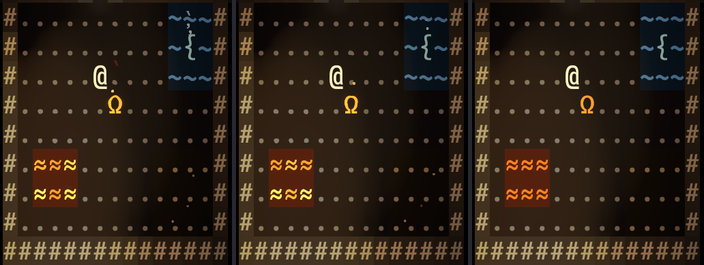
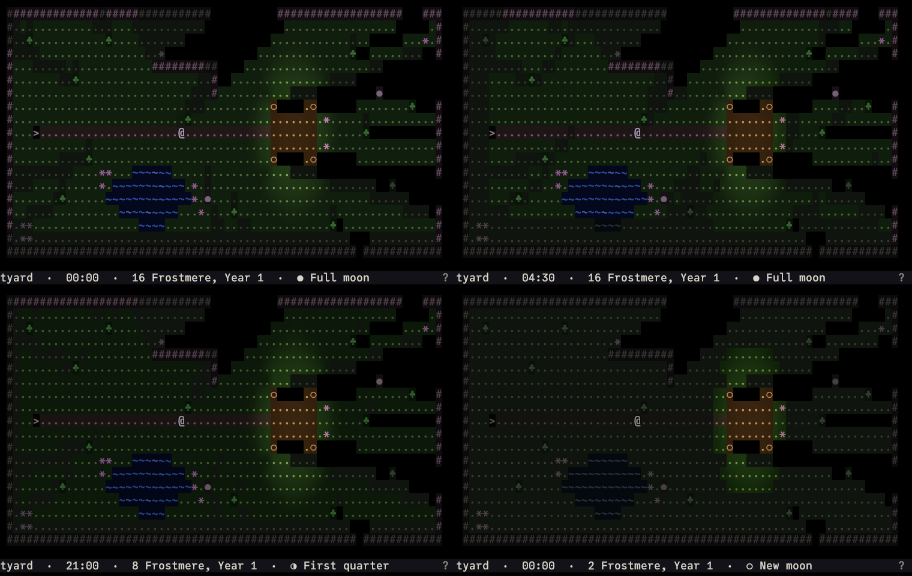
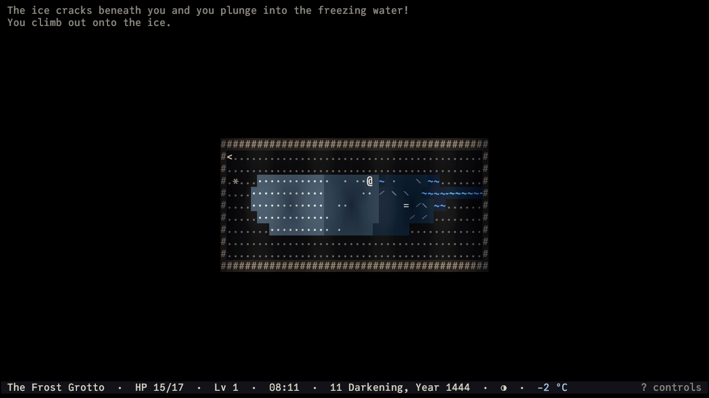
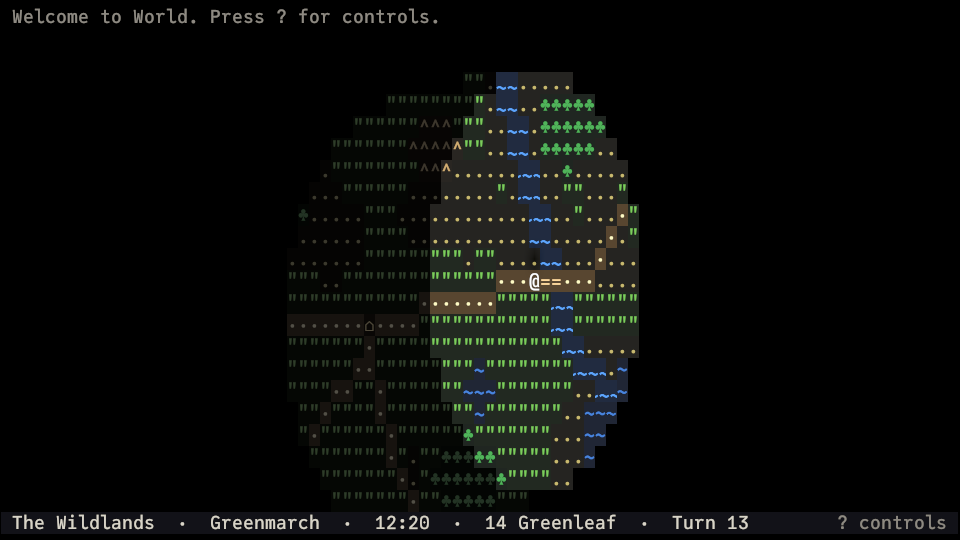
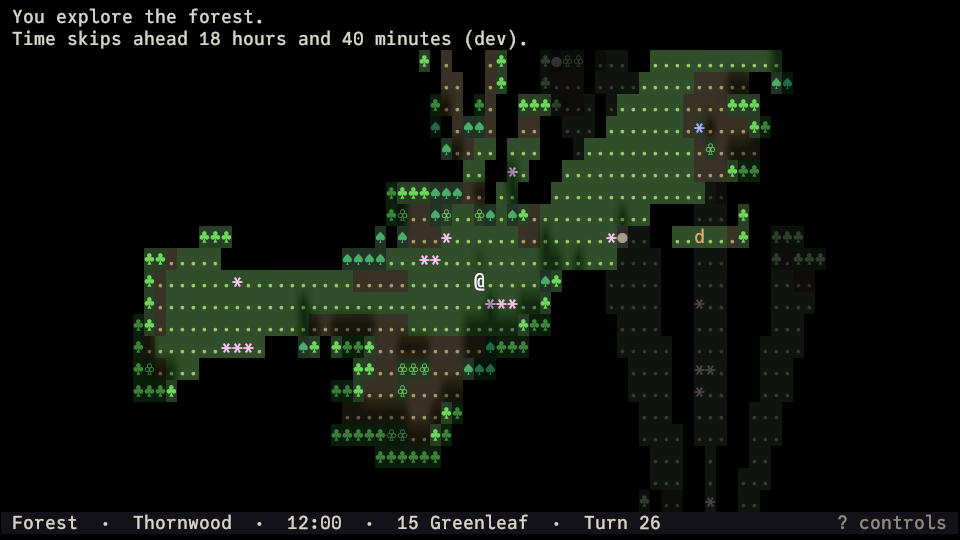

# What's in the game

An overview of what the game does today, feature by feature; the other pages explain the
rules behind each.

This is the engine and framework phase: [creatures](creatures.md) hunt you, fight, shoot, and die (their [spells](magic.md)
are only announced so far, though yours are real), [death](combat.md#death) is permanent, and you grow by [experience levels](experience.md#levels) and by [skills](skills.md) that
improve with use. You come into **[the Ascmearc](ascmearc.md)** through a mountain pass that closes behind you
(see [The Ascmearc](ascmearc.md)): an ADOM-like **[overworld](overworld.md)** with [day and night](time.md#days) and [weather](weather.md#how-the-weather-changes),
outdoor areas [generated from it](overworld.md#local-areas), the market town of [Cēaptūn](ascmearc.md#the-places), and procedurally generated
[dungeons](dungeons.md) under the barrows, the fen, and the hills.

- **[Light and vision](light.md)** — every cell carries RGB + UV [light](light.md#what-light-is) from [torches](light.md#light-sources), lamps, crystals, braziers,
  and your [lantern](lantern.md), with shadows from walls and pillars, soft shadows from creatures, and a weak
  bounce of light off nearby surfaces. Firelight drifts gently in hue and strength; magical light
  holds steady. What you see depends on your eyes: [normal
  vision](vision.md#the-four-types) needs light, [low-light](vision.md#the-four-types) eyes see by faint fungus glow, [darkvision](vision.md#the-four-types) sees in the dark in
  fading monochrome, and [UV sight](vision.md#the-four-types) reveals runes no one else can see.

  

- **[Creatures](creatures.md)** — every creature acts at its own [pace](turns.md#speed) (some twice for each of your turns, some
  less; the game never tells you) and belongs to a [faction](creatures.md#factions) that is hostile or neutral to you and to
  the others. Hostile creatures see by the same rules of [light](light.md#what-light-is) and eyes as you do, then approach
  and attack, keep their distance and shoot, or cast from afar, entirely deterministically; when
  they lose you, they search where they last saw you, follow noises, and return to their rounds.

- **[Hearing](hearing.md)** — [footsteps](hearing.md#what-makes-noise), [doors](doors.md), and fights make [noise](hearing.md#what-makes-noise) that travels around corners, is muffled by
  closed doors, and is [louder](hearing.md#how-loud) in water and rubble than on grass. You hear what you cannot see as
  faint marks on the map and short messages ("You hear footsteps to the north-east."), without
  learning who made them; creatures hear you too and come to look.
- **[Perception and memory](sight.md)** — symmetric [line of sight](sight.md#line-of-sight); explored terrain and the objects seen on
  it stay as dim [memory](sight.md#memory), never showing creatures or current light.
- **[Objects](objects.md)** — [weapons](objects.md#class-melee-weapons), [armor](objects.md#class-body-armour), [tools](objects.md#class-tools), [potions](potions.md), [scrolls](scrolls.md), [food](food.md), [gems](gems.md), [coins](objects.md#class-coins), [rings](objects.md#class-rings), and [amulets](objects.md#class-amulets),
  each with its own glyph, color, [material](objects.md#materials), and weight, lie in [piles](objects.md#piles) to pick up and drop; an
  ADOM-style [inventory](objects.md#your-pack) lettered a–z shows what you carry and what it weighs, and an ADOM-style
  [equipment](equipment.md) screen puts it on: [helm](objects.md#class-helmets), [amulet](objects.md#class-amulets), [armor](objects.md#class-body-armour), [cloak](objects.md#class-cloaks), weapons and [shield](objects.md#class-shields) (or a second, light
  weapon, or a two-handed staff or great sword), [gloves](objects.md#class-gloves), [rings](objects.md#class-rings), [boots](objects.md#class-boots), a bow and arrows, and a
  tool. Creatures [wield and wear](equipment.md#what-fits-where) what they carry, and you see it.
- **[Digging](digging.md)** — walls give way: ready a pick-axe or a mattock in the Tool [slot](equipment.md#what-fits-where) and dig, turn after
  turn, through packed earth in a minute, a stone wall in a few, granite in half an hour or so
  ([Strength](stats.md#stat-strength) helps, a heavy load slows you), until a creature comes into view or the wall crumbles
  to rubble; light and sight spill through at once. Digging is [loud](hearing.md#how-loud). A [fireball](magic.md#spell-fireball) blows the softer
  walls apart.
- **[Combat](combat.md)** — D&D-style with [two twelve-sided dice](combat.md#hitting): every blow and shot is rolled against
  [Defence](combat.md#defence) ([Dexterity](stats.md#stat-dexterity), armour, shield, [parry](combat.md#defence), a beetle's shell), misses say why ("You block the
  kobold's spear with your shield."), [criticals](combat.md#criticals) threaten and confirm ("The kobold hits you
  hard!"), armour and hides soak damage like ADOM's PV ("Your sword glances off the cave beetle's
  shell."), and weapons and armour come from data. ADOM-like [hit points](combat.md#hit-points) from [Toughness](stats.md#stat-toughness), [race](races.md), and
  [class](classes.md) [heal](healing.md#how-fast) with time; creatures die and drop what they carried, look as hurt as they are, and
  your own death ends the run for good: the [save](saving.md) is gone.
- **[Experience](experience.md)** — every creature has a level and an [XP](experience.md) value; kills you make yourself (melee,
  shots, throws) earn XP, less and less the further the monster is below your level, as in World
  of Warcraft (nothing from grey ones, a little extra from tougher ones). [Levels](experience.md#levels) run to 50 and, up
  to level 50, make you hardier. Your level and XP show on the [status bar](controls.md#the-screen), the [character screen](controls.md#character),
  and the death screen.
- **[Magic items](magic-items.md)** — after Path of Exile: sixty [base items](magic-items.md#base-items) (daggers to great axes, bows and
  crossbows, padded coats to plate, helms, cloaks, gloves, boots, shields, rings, amulets) roll
  [prefixes](magic-items.md#prefixes) and [suffixes](magic-items.md#suffixes) from 47 affixes in tiers that deepen with the [dungeon](dungeons.md). A magic item has one
  or two ("Sharp long sword of the Bear", in blue); a [rare](magic-items.md#rarity) one up to six and a name ("Grim Bite,
  long sword", in yellow). Found [unidentified](magic-items.md#unidentified-items), they work all the same; each remembers what it
  rolled. They lie in the dungeons, in vaults, and fall from slain creatures, and an item's
  description says what it does in plain words. A glowing helm lights your way.
- **[Gems](gems.md)** — ten gems from smokestone to diamond, each of a [size and a cut](gems.md#size-and-cut) (uncut included), are
  rare finds, larger and finer deeper down, and what rings, amulets, and now and then weapons,
  shields, and helms are set with: "an emerald-pommelled long sword", "a gold and ruby ring".
  General [stores](shops.md) buy them at what they are worth.
- **[Materials](objects.md#materials)** — seventeen metals, from tin to nicrosil, and woods, bones, stones, hides, and
  cloths, each with its weight, what it does as a blade or as armour, its worth, and its colour.
  Items are found made of other materials than their usual one, by what each may be made of: "a
  bronze long sword" (heavier, a little weaker, cheaper), "a flint spear", "a dragonbone
  quarterstaff". Copper and bronze are common near the surface, steel deeper; [kobolds](creatures.md#creature-kobold) carry
  bone, flint, and bronze.
- **[Scrolls](scrolls.md)** — found under labels ("a scroll labelled ZUNBAR") until you read or [identify](magic-items.md#unidentified-items)
  one; read with `r`: every [spell](magic.md) comes on a scroll that casts it once, free of [mana](mana.md#how-much), where you
  aim it (a [fireball](magic.md#spell-fireball) read too close asks first), and what it kills is yours; [studied](magic.md#learning-spells-from-scrolls) with `L`, a
  scroll teaches you its spell for good; a [scroll of identify](scrolls.md#scroll-of-identify) tells you what an unidentified item
  is. They lie in the [dungeons](dungeons.md) and sell in general [stores](shops.md).
- **[Magic](magic.md)** — [spells](magic.md#the-spells) of [levels](magic.md#spell-levels) 0 to 70 ([cantrips](magic.md#spell-levels) at 0 and 1), cast from the [abilities menu](abilities.md#the-abilities-menu) for
  [mana](mana.md#how-much) by its level: a few come with a casting [class](classes.md), the rest are learned from scrolls, and one far
  above your [caster level](magic.md#caster-level) is hard to learn and can go badly wrong. Rays and bolts, cones, lines,
  and bursts, each with dice of its own and [ladders](magic.md#the-spells) your stats climb. [Wands](magic.md#wands) cast
  their spell from their charges at a rung of their own, for anyone; [rods](magic.md#rods) do what no spell does (digging, sleep,
  terror, teleport other) for your own mana (see [Magic](magic.md)).
- **[People and talk](npcs.md)** — [Cēaptūn](ascmearc.md#the-places) has folk to talk to: townsfolk on the square, Sister Hild in the
  Mynster, Godgifu at the inn, the reeve and the mine-factor. [Chat](npcs.md#chatting) with `C`: most say a
  one-liner, a different one each time; some have [topics](npcs.md#chatting) to ask about on a small dialogue
  screen (Godgifu has news of the barrows, the marsh, the mines, the volcano, and the pass), and
  Sister Hild sells a [cure and a mending](npcs.md#services) for [gold](shops.md#money). They mutter to themselves
  now and then, which you may overhear through a wall. Walking into anyone who is not hostile
  swaps places with them, so nobody blocks a corridor (a few will not budge).
- **[Quests](quests.md)** — simple, ADOM-like errands from the people you meet, offered through their topics:
  kill something, bring something, go somewhere, or carry something to someone else. Asking
  gives you the quest; follow it in the [quest log](quests.md#the-quest-log) (`q`), and come back for gold, things, and
  experience.
  Some quests tell you where a [hidden place](overworld.md#hidden-locations) lies and mark it on your map: in Cēaptūn the reeve,
  Sister Hild, and the mine-factor each have a chain of them.
- **[Ranged combat](ranged.md)** — bows (drawn by [Strength](stats.md#stat-strength)), a crossbow, a sling, and [throwing weapons](ranged.md#shooting-and-throwing); [aim](controls.md#aiming)
  ADOM-style with a cursor and a faint line of fire, watch the arrow fly, and pick it up where it
  fell. A [flaming arrow](ranged.md#flaming-arrows) flies burning and lights the dark where it lands until it burns out:
  shoot one into the dark to see what waits there (and be seen).
- **[Blood](combat.md#blood)** — big hits and kills stain the floor and the walls beside the victim, by its size and
  how the blow landed; subtle for one kill, a slaughterhouse where many fell (a [setting](settings.md) hides it).
- **[Weapon skills](weapon-skills.md)** — ADOM-style: every blow, shot, and throw earns marks in its weapon's skill
  (daggers, long blades, axes, bows, …, sixteen in all, shield blocking and shield bashing among
  them), and [ranks](weapon-skills.md#marks-and-ranks) 0 to 10 come slower and slower; each rank makes you hit, hurt, parry, or
  block a little better ("You feel more skilled with long blades."). Skill carries over to
  [related weapons](weapon-skills.md#related-skills), as in *The Riddle of Steel*: long blades 8 makes short blades 6. Your race and
  class start you off, a [weapon skills screen](controls.md#info-pages) shows your ranks, and a shield can [bash](abilities.md#ability-shield-bash) too.
- **[Fighting styles](fighting-styles.md)** — after AD&D's *Complete Fighter's Handbook*, how you hold your weapons is a
  skill of its own: [Duelist](fighting-styles.md#style-duelist), [Twin Blades](fighting-styles.md#style-twin-blades), [Great Weapon](fighting-styles.md#style-great-weapon), [Sword and Board](fighting-styles.md#style-sword-and-board), [Marksman](fighting-styles.md#style-marksman), [Skirmisher](fighting-styles.md#style-skirmisher),
  [Brawler](fighting-styles.md#style-brawler), and [Staff Fighter](fighting-styles.md#style-staff-fighter), each with ranks 0 to 10 trained by fighting that way and benefits
  that add to your weapon's (a duelist parries, a great weapon hits harder, sword and board may
  follow a hit with a free shield bash). A light weapon in your [off hand](fighting-styles.md#two-weapons) strikes too, at a
  penalty that Twin Blades trains away. Your class starts you off; the weapon skills screen
  marks the styles you fight in.
- **[Status effects](status-effects.md#how-they-work) and [healing](healing.md#how-fast)** — big hits and criticals open [bleeding](status-effects.md#bleeding) wounds, a [giant rat's](creatures.md#creature-rat)
  bite may leave [poison](status-effects.md#poisoned) behind; they cost hit points as time passes, stack, wear off, slow or
  stop healing, and can kill (creatures bleed to death too); strong poison saps [Strength](stats.md#stat-strength) and
  [Dexterity](stats.md#stat-dexterity). The status bar names what ails you, [look mode](controls.md#look-mode) shows a creature bleeding; never a
  number. Hit points come back twice as fast while you [rest](resting.md#how-resting-works).
- **[Mana](mana.md)** — a second pool beside your [hit points](combat.md#hit-points), for spells and rods: from your race and
  class, your [Intelligence](stats.md#stat-intelligence), [Willpower](stats.md#stat-willpower), and [Presence](stats.md#stat-presence), your levels, and magic items. It comes back
  with time by your Willpower, faster while you rest or in a [sanctuary](special-rooms.md#room-sanctuary), slower while poisoned or
  diseased, not at all while starving. The status bar shows it (`MP 5/12`).
- **[Resources](resources.md)** — pools of your own beside hit points and mana, such as a barbarian's [rage](resources.md#rage) or a
  ranger's [focus](resources.md#resource-focus): some come back with time, some wear off, some build up from kills and blows,
  abilities spend them, and some end when they run out. You may hold several; the status bar
  shows each one you hold (`Rage 7`, `Focus 7/10`).
- **[Diseases](diseases.md)** — [filth fever](diseases.md#disease-filth-fever) from a rat's bite, [marsh ague](diseases.md#disease-marsh-ague) from the swamps, [grave rot](diseases.md#disease-grave-rot) from
  rotten food, and more, in the spirit of D&D 3.5: caught unseen when a hidden [check](diseases.md#checks) fails, they
  [incubate](diseases.md#how-a-disease-goes) for days, then you are [Diseased](status-effects.md#status-diseased). Each day your body fights back with another check;
  a loss takes points off your [stats](stats.md) ([Toughness](stats.md#stat-toughness) damage lowers your hit points), two wins in a
  row shake it off, and grave rot never goes by itself. The [character screen](controls.md#character) names the disease
  once it has run a day; lost stat points [mend](stats.md#drained-stats) a point a day once you are well.
- **[Traps](traps.md)** — arrow and spear traps, fireballs, lightning bolts, pits, alarms, and teleports lie
  hidden until someone steps on them: you, or a creature you lure there; a [trapped door](traps.md#trapped-doors) goes off
  when someone opens or kicks it. One you saw go off is [known](traps.md#finding-traps) from then on, shown as `^` and
  remembered, and stepping onto it asks first. The dungeons hide a few on every level.
- **[Searching](searching.md)** — [secret doors](doors.md#secret-doors) look like the wall and [hidden traps](traps.md#finding-traps) like the floor until you find
  them: [search](searching.md#searching-1) (`s`, or `S` for a while) with your [Intelligence](stats.md#stat-intelligence) and [Search](skills.md#skill-search) skill, or [notice them in
  passing](searching.md#noticing-in-passing) with your [Willpower](stats.md#stat-willpower), if you are an [elf](races.md#race-elf), a [dwarf](races.md#race-dwarf) (in stone), or trained in [Spot](skills.md#skill-spot); hidden
  traps are your [Detect traps](skills.md#skill-detect-traps) skill's, both ways ([thieves](classes.md#thief) start trained in it). Every
  turn is a fresh try. The dungeons hide a door or two on their levels of rooms, never one you
  need.
- **[Burden](burden.md)** — everything you carry weighs on you: past a third of what your [Strength](stats.md#stat-strength) and
  [Toughness](stats.md#stat-toughness) can bear you are [burdened](burden.md#burden-1), then [strained](burden.md#burden-1), then [overloaded](burden.md#burden-1). Every action takes longer,
  armour-like caps keep your Dexterity from helping your Defence, and your [footsteps](hearing.md#what-makes-noise) get louder.
  [Dwarves](races.md#race-dwarf) shrug off the first level. The inventory shows where the thresholds lie.
- **[Doors](doors.md)** — some are [locked](doors.md#locked-doors), and look like any other until you try them: a [key](doors.md#keys) made for the
  lock, or a [skeleton key](doors.md#keys), opens it. Or [kick](doors.md#kicking) it in (`k`): the stronger you are, the sooner it
  breaks, and every kick bangs through the halls. [Kobolds](creatures.md#creature-kobold) open doors, but a locked one only with
  its key; the dungeon's locked rooms always leave their key within reach.
- **[Hunger](hunger.md)** — ADOM-style: time empties your stomach ([resting](resting.md#how-resting-works) and long journeys too), faster for
  a [halfling](races.md#race-halfling) than an [elf](races.md#race-elf). [Hungry](hunger.md#how-hungry-you-are), then [weak](hunger.md#how-hungry-you-are), [fainting](hunger.md#how-hungry-you-are), and [starving](hunger.md#how-hungry-you-are) to death; eat too much and
  you are [bloated](hunger.md#how-hungry-you-are) and slow, or vomit. [Eat](food.md#eating) rations, bread, and apples before they [spoil](food.md#food-spoils), or the
  [corpses](food.md#corpses) creatures leave behind: they weigh what the creature did, rot within a day or two, and
  some do more than feed you (a kobold tastes terrible; a [beetle](creatures.md#creature-beetle) might toughen you). Rotten food
  makes you sick. Cēaptūn's provisioner sells food.
- **[Stats](stats.md)** — [Strength](stats.md#stat-strength), [Dexterity](stats.md#stat-dexterity), [Toughness](stats.md#stat-toughness), [Intelligence](stats.md#stat-intelligence), [Willpower](stats.md#stat-willpower), and [Presence](stats.md#stat-presence), inspired by
  D&D, for you and every creature; a [character screen](controls.md#character) shows your own. Strength, Dexterity, and
  Toughness count in a fight, and Strength [kicks doors in](doors.md#kicking); Intelligence and Willpower find hidden things ([Searching](searching.md)), Willpower brings [mana](mana.md#how-fast-it-comes-back) back, and Presence sways [shop prices](shops.md#prices).
- **[Character creation](character.md)** — ADOM-style, at the start of every run: thirteen [races](races.md) ([elf](races.md#race-elf), [half-elf](races.md#race-half-elf),
  [human](races.md#race-human), [dwarf](races.md#race-dwarf), [halfling](races.md#race-halfling), [gnome](races.md#race-gnome), [half-orc](races.md#race-half-orc), and the [evil](races.md#the-evil-races) [goblin](races.md#race-goblin), [drow](races.md#race-drow), [kobold](races.md#race-kobold), [lizardfolk](races.md#race-lizardfolk),
  [duergar](races.md#race-duergar), and [ratfolk](races.md#race-ratfolk)), each with its own eyes, three [genders](character.md#gender), and fifteen
  [classes](classes.md) from [barbarian](classes.md#barbarian) and [wizard](classes.md#wizard) to [merchant](classes.md#merchant) and [commoner](classes.md#commoner) shape your starting stats and
  skills, with dice rolled in the background (a [warrior's](classes.md#warrior) Strength is 1d3+1). Your [age and birthday](character.md#age-birthday-and-sign) are
  random, and the year you were born gives you a [horoscope](horoscope.md) sign: one of twelve mythological
  [animals](horoscope.md#animals) and five [elements](horoscope.md#elements), sixty signs in a [great cycle](horoscope.md#the-great-cycle) (the Fire Manticore, the Water
  Basilisk). Not balanced, on purpose: some characters are a challenge.
- **[Skills](skills.md)** — 27 ADOM-like skills, from [stealth](skills.md#skill-stealth) and [tumble](skills.md#skill-tumble) to [open lock](skills.md#skill-open-lock) and [spellcraft](skills.md#skill-spellcraft). Your race
  and class train you in a few; the rest you simply do not have. Skills grow with use (each
  meaningful use may earn a [training mark](skills.md#getting-better); past 100 they grow slowly), and the passive ones help
  already: [tumbling](skills.md#skill-tumble) adds to your Defence, [stealth](skills.md#skill-stealth) quiets your steps and doors, [listening](skills.md#skill-listen) lets you
  hear fainter sounds, [balance](skills.md#skill-balance) eases a heavy load, and [survival](skills.md#skill-survival) speeds your journeys. A Skills
  [screen](controls.md#skills) (`A`) shows their values, never the numbers behind them.
- **[Abilities](abilities.md)** — unlike ADOM's key for each, one [menu](abilities.md#the-abilities-menu) (`a`) holds everything you can do
  because of who you are: a [shield bash](abilities.md#ability-shield-bash), the skills you use as actions, and later racial, class,
  and item abilities. What you cannot use right now is greyed out with why, and `X` repeats the
  last one.
- **[Living glyphs and effects](settings.md)** — still ponds that glint in the torchlight, streams and a river
  that visibly flow and foam against rocks, a pulsing altar, flickering torches, sparks and
  embers, a soft glow, heat haze over braziers, short fades. All of it is tunable per effect, and
  a reduced-effects preset turns it off.

  

- **[Sunlight](sun.md)** — a game clock moves the sun across the sky of outdoor levels: warm and low at dawn
  and dusk, white at noon, with a dim blue [sky light](sun.md#sky-light) in the shade and shadows from trees, walls,
  and stones that turn and stretch with it.

  

- **[Moonlight](sun.md#moonlight)** — by night a faint, slightly purple moon lights the land, waxing and waning with
  the 30-day month and rising about 50 minutes later each day: under a full moon you dimly make out
  open ground (not what lies in its shadows), low-light eyes see by a half moon, and a new moon
  leaves you to your lantern. Moons cast shadows like the sun, widen your sight on the overworld,
  and are data: add more, bigger or faster ones. The status bar shows the date and the [phase](sun.md#phases).

  

- **[Weather](weather.md)** — clear skies, overcast, rain, and heavy rain come and go with the season (Rainmoon is
  wet, Highsun dry). Clouds dim the sun and the moon and flatten shadows, for you and every
  creature alike; rain shortens your sight on the overworld, falls as faint drops, and rings the
  ponds. The status bar shows the weather when you are outside.

  

- **[Temperature and ice](temperature.md)** — every place has a temperature, shown in the status bar (°C or °F):
  cool and steady underground, outdoors following the month, the hour, and the weather (clear
  nights are cold). Water freezes slowly in the cold and thaws in the warmth, even while you are
  away: thin ice with hairline cracks over dark water, then a grey-blue sheet, then thick white
  ice. [Ice holds](temperature.md#walking-on-ice) by its thickness against your weight and everything you carry; a laden dwarf
  breaks through where a light elf crosses, [plunges into the freezing water](temperature.md#falling-in), and climbs out in a
  few turns, while what lay on the ice sinks to the bottom.

  

- **[Overworld and time](overworld.md)** — a 12-month, 30-day [calendar](time.md#the-calendar) and a clock that every action advances.
  The Ascmearc's overworld takes real [travel](overworld.md#travel) time per step (a road is quick, a swamp slow,
  mountains impassable); how far you see follows the daylight and the moon. Its [locations](overworld.md#locations) lead to
  the town and the dungeons (two of them [hidden](overworld.md#hidden-locations) until a quest tells you where), and any other
  cell opens a generated outdoor [area](overworld.md#local-areas) — meadows, forests, hills, swamps, riverbanks — that you
  leave by walking off its edge.

  

  

- **[Levels](dungeons.md)** — the overworld and the market town, made by hand, and the dungeons:
  rooms-and-corridors and cave levels generated for each run, with hand-made vaults stamped in,
  where creatures of the floor's [danger](dungeons.md#who-lives-there-and-how-many) keep coming (see [Dungeons and danger](dungeons.md)).
- **[Special rooms](special-rooms.md)** — ADOM-like, some dungeon levels have a room that changes
  the rules inside it, announced the first time you step in: a [shadowed room](special-rooms.md#room-shadowed) that drains every
  light, an [echoing hall](special-rooms.md#room-echoing) that makes every sound loud, a [hushed chamber](special-rooms.md#room-hushed) for sneaking, a softly
  glowing [sanctuary](special-rooms.md#room-sanctuary) where wounds heal fast and nothing hostile follows you in (Cēaptūn's
  Mynster is one), and a [flooded room](special-rooms.md#room-flooded) of splashing shallow water.
- **[Shops](shops.md)** — ADOM-like general stores and specialty shops (a weaponsmith, an armourer, a
  provisioner, a fletcher), each kept by a named [shopkeeper](creatures.md#creature-shopkeeper) by the door: goods show their [price](shops.md#prices)
  in [gold](shops.md#money), what you pick up you owe until you pay (`p`, or when you leave), the keeper makes an
  [offer](shops.md#selling) for what you drop, and your [Presence](stats.md#stat-presence) and the [Negotiation](skills.md#skill-negotiation) skill get you better prices.
  The keeper won't let you out of the door owing money; leave another way ([dig](digging.md) through the wall)
  and the shopkeeper, tough and well armed, comes after you. Cēaptūn has four shops on its
  square, and now and then a dungeon level has one.

  

- **[Saves](saving.md)** — one save per run, written when you quit and [autosaved](saving.md#when-the-game-saves) as you play (in the browser
  too); when you die, it is deleted.
- **[Settings](settings.md)** — font size, color [palettes](settings.md#palettes) (including high contrast and a colorblind-friendly
  variant), per-effect switches, °C or °F, and fully [rebindable keys](controls.md#rebinding-keys).
- **Everywhere** — Windows, macOS, Linux, and the browser (WebGPU).
