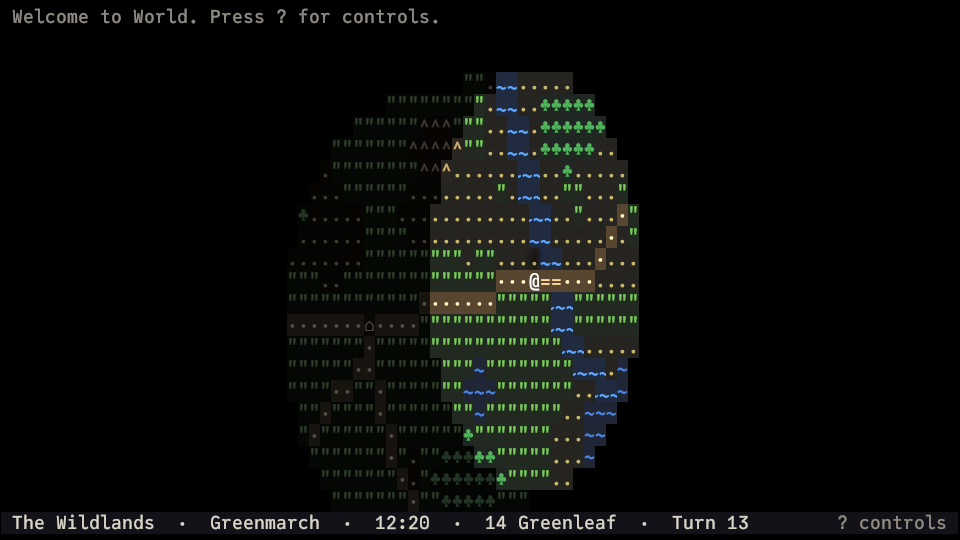
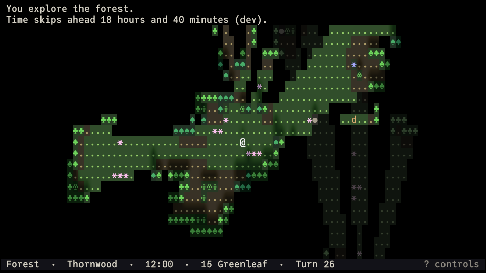
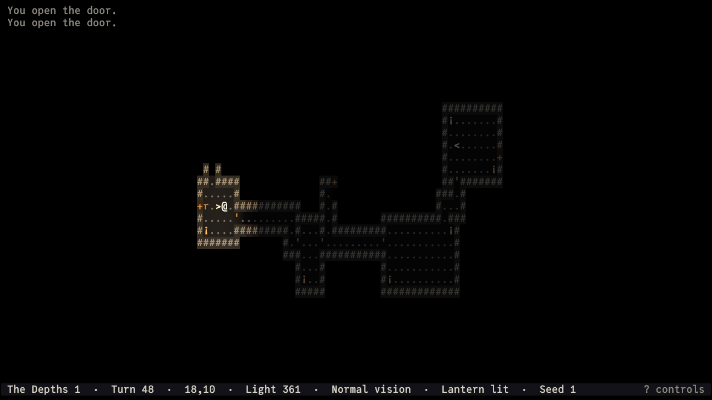
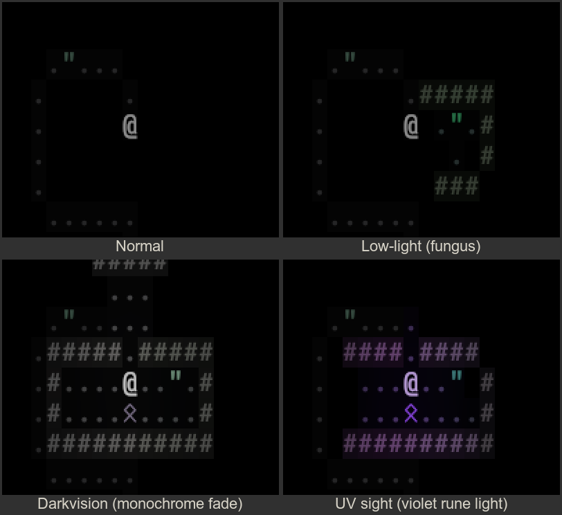
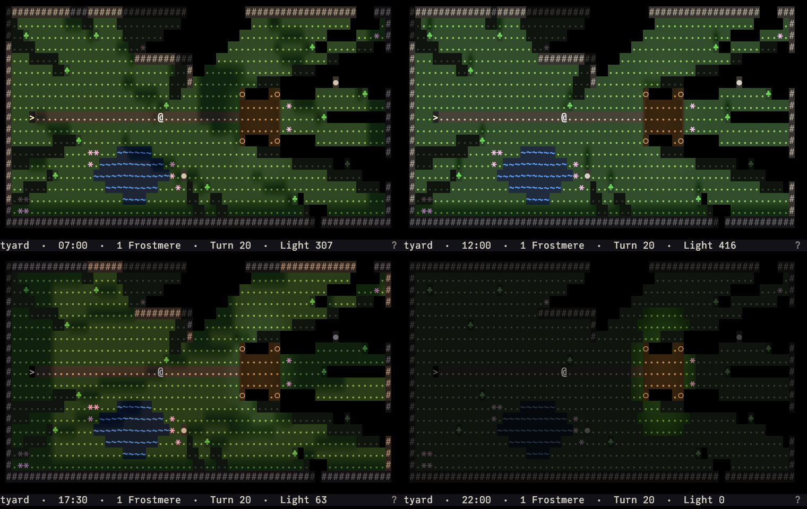
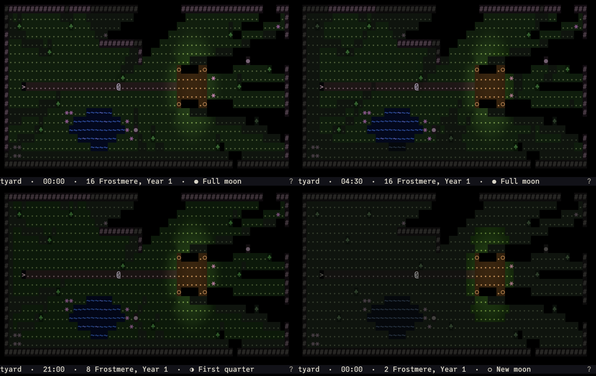
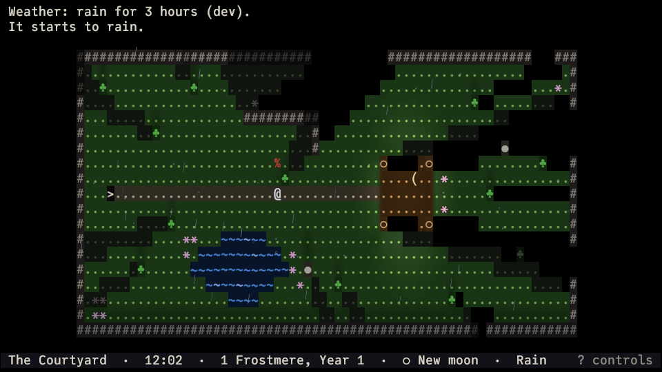
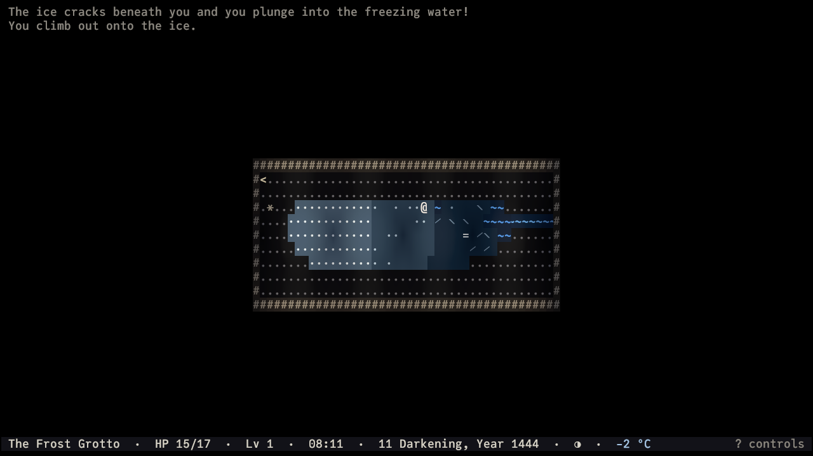
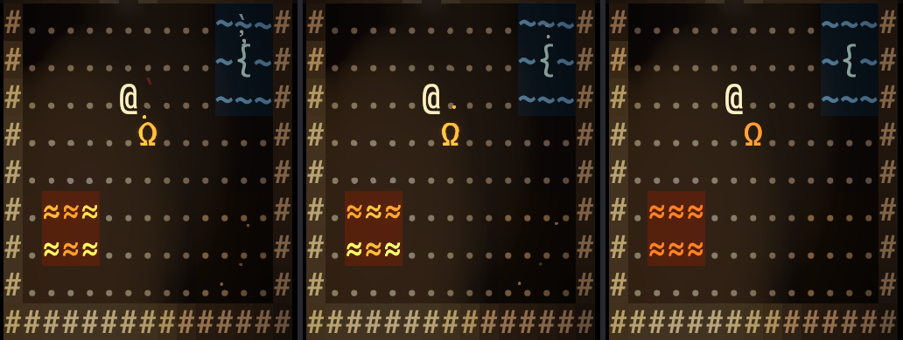

# What's in the game

A short tour of what the game has today. Each section links to the page that explains the rules.

[Creatures](creatures.md) hunt you, fight, shoot, cast [spells](magic.md), and die. Your own
[death](hit-points.md#death) is permanent. You grow by [experience levels](experience.md#levels)
and by [skills](skills.md) that improve with use.

## The world

You come into **[the Ascmearc](ascmearc.md)** through a mountain pass that closes behind you. It
is an [overworld](overworld.md) with a 12-month, 30-day [calendar](time.md#the-calendar), [day and
night](time.md#days), and [weather](weather.md#how-the-weather-changes). Every step across it
takes real [travel](overworld.md#travel) time: a road is quick, a swamp slow, and mountains cannot
be crossed. Its [locations](overworld.md#locations) lead to the market town of
[Cēaptūn](ascmearc.md#the-places) and to the dungeons. Two of them stay
[hidden](overworld.md#hidden-locations) until a quest tells you where they are. Any other cell
opens an outdoor [area](overworld.md#local-areas) made for your run (meadow, forest, hills, swamp,
or riverbank), which you leave by walking off its edge.

The [dungeons](dungeons.md) lie under the barrows, the fen, and the hills. Their levels, rooms and
corridors or caves, are made anew for each run, with hand-made vaults set into them. Creatures
of the floor's [danger](dungeons.md#who-lives-there-and-how-many) keep coming. Some levels have a
[special room](special-rooms.md) that changes the rules inside it, such as a [shadowed
room](special-rooms.md#room-shadowed) that drains all light or a [sanctuary](special-rooms.md#room-sanctuary)
where wounds heal fast and nothing hostile follows you in.

## Light, sight, and sound

Every cell carries [light](light.md#what-light-is) from [torches](light.md#light-sources), lamps,
crystals, braziers, and your [lantern](lantern.md). Walls and pillars cast shadows, and creatures
cast soft ones. Firelight drifts gently in hue and strength; magical light holds steady.

What you see depends on your eyes. [Normal vision](vision.md#the-four-types) needs light.
[Low-light](vision.md#the-four-types) eyes see by faint fungus glow.
[Darkvision](vision.md#the-four-types) sees in the dark, in fading grey. [UV
sight](vision.md#the-four-types) reveals runes no one else can see. Explored ground stays on the
map as dim [memory](sight.md#memory).

[Footsteps](hearing.md#what-makes-noise), [doors](doors.md), and fights make noise that travels
around corners. You hear what you cannot see as faint marks on the map and short messages ("You
hear footsteps to the north-east."). Creatures hear you too, and come to look.

## The sky

The [sun](sun.md) crosses the sky of outdoor levels: warm and low at dawn and dusk, white at noon.
Shadows from trees, walls, and stones turn and stretch with it.

By night a faint [moon](sun.md#moonlight) lights the land, waxing and waning with the month. Under a
full moon you dimly make out open ground. Low-light eyes see by a half moon. A new moon leaves
you to your lantern.

[Weather](weather.md) comes and goes with the season: clear, overcast, rain, and heavy rain.
Clouds dim the sun and the moon for you and every creature alike. Rain shortens your sight on the
overworld.

Every place has a [temperature](temperature.md). Water freezes slowly in the cold and thaws in
the warmth, even while you are away. [Ice holds](temperature.md#walking-on-ice) by its thickness
against your weight: a laden dwarf breaks through where a light elf crosses, and
[falls into the freezing water](temperature.md#falling-in).

## Your character

You make a [character](character.md) at the start of every run. There are thirteen
[races](races.md), each with its own eyes, three [genders](character.md#gender), and fifteen
[classes](classes.md), from [berserker](classes.md#berserker) and [wizard](classes.md#wizard) to
[merchant](classes.md#merchant) and [commoner](classes.md#commoner). Your year of birth gives you a
[horoscope](horoscope.md) sign. Characters are not balanced, on purpose: some are a challenge.

Six [stats](stats.md) describe you and every creature. [Skills](skills.md) such as
[Stealth](skills.md#skill-stealth) and [Open lock](skills.md#skill-open-lock) grow with use. Every
kill you make earns [experience](experience.md); [levels](experience.md#levels) run to 60. One
[menu](abilities.md#the-abilities-menu) (`a`) holds everything you can do because of who you are.

## Fighting

Every blow and shot is rolled with [two twelve-sided dice](combat.md#hitting) against
[Defence](combat.md#defence). A miss tells you why ("You block the kobold's spear with your
shield."). [Criticals](combat.md#criticals) hit hard, and armour and hides soak damage ("Your sword
glances off the cave beetle's shell."). Creatures look as hurt as they are, and drop what they
carried when they die.

[Weapon skills](weapon-skills.md) and [fighting styles](fighting-styles.md) improve as you fight.
[Ranged combat](ranged.md) has bows, a crossbow, a sling, and [throwing
weapons](ranged.md#shooting-and-throwing); you [aim](controls.md#aiming) with a cursor and pick
up your arrows where they fell. Big hits leave [blood](hit-points.md#blood) on the floor and the
walls.

Wounds can [bleed](status-effects.md#bleeding), bites can [poison](status-effects.md#poisoned), and
[diseases](diseases.md) take points off your stats. [Hit points](hit-points.md#hit-points) come
back with [time](healing.md#how-fast), twice as fast while you [rest](resting.md#how-resting-works).

## Magic

[Spells](magic.md#the-spells) cost [mana](mana.md#how-much). A few come with a casting class; the
rest are learned from [scrolls](scrolls.md). [Wands](wands-and-rods.md#wands) cast their spell
from charges, for anyone. [Rods](wands-and-rods.md#rods) do what no spell does, such as digging or
sending a creature away, for your own mana. Some classes use [resources](resources.md) of their
own, such as a berserker's [rage](resources.md#rage).

## Things to find and use

[Objects](objects.md) lie in [piles](objects.md#piles) to pick up and drop: weapons, armour, tools,
[potions](potions.md), [scrolls](scrolls.md), [food](food.md), [gems](gems.md), coins, rings, and
amulets. Each is made of a [material](materials.md#materials), from tin to nicrosil. You put things
on in the [equipment](equipment.md) screen. Everything you carry has weight, and too much leaves
you [burdened](burden.md).

[Magic items](magic-items.md) roll [prefixes](affixes.md#prefixes) and
[suffixes](affixes.md#suffixes): "Sharp long sword of the Bear" in blue, or a
[rare](magic-items.md#rarity) one with a name of its own, "Grim Bite, long sword", in yellow. They
work even while [unidentified](magic-items.md#unidentified-items).

You get [hungry](hunger.md). [Eat](food.md#eating) rations, bread, and apples before they
[spoil](food.md#food-spoils), or the [corpses](food.md#corpses) creatures leave behind.

## The dungeon's defences

Some [doors](doors.md) are [locked](doors.md#locked-doors): open them with a [key](doors.md#keys),
or [kick](doors.md#kicking) them in (`k`). [Traps](traps.md) lie hidden until someone steps on
them. [Secret doors](doors.md#secret-doors) look like the wall until you
[search](searching.md#searching-1) (`s`) or [notice them in passing](searching.md#noticing-in-passing).
With a pick-axe you can [dig](digging.md) through walls.

## People, quests, and shops

[Cēaptūn](ascmearc.md#the-places) has folk to [chat](npcs.md#chatting) with (`C`). Some have
[topics](npcs.md#chatting) to ask about, and some sell [services](npcs.md#services) for
[gold](shops.md#money). [Quests](quests.md) come from the people you meet: kill something, bring
something, go somewhere, or carry something to someone. Some tell you where a [hidden
place](overworld.md#hidden-locations) lies.

[Shops](shops.md) show the [price](shops.md#prices) of their goods. What you pick up you owe until
you pay (`p`). Your [Presence](stats.md#stat-presence) and the [Negotiation](skills.md#skill-negotiation)
skill get you better prices. Cēaptūn has two shops on its square, and now and then a dungeon
level has one.

## Effects and settings

Ponds glint in the torchlight, streams flow and foam against rocks, torches flicker, and braziers
throw sparks and heat haze. Every effect can be turned off on its own in the
[settings](settings.md), and a reduced-effects preset turns them all off. Settings also cover font
size, color [palettes](settings.md#palettes) (including high contrast and a colorblind-friendly
one), °C or °F, and fully [rebindable keys](controls.md#rebinding-keys).

The game [saves](saving.md) one file per run, when you quit and [as you play](saving.md#when-the-game-saves).
When you die, the save is deleted. It runs on Windows, macOS, Linux, and in the browser (WebGPU).
